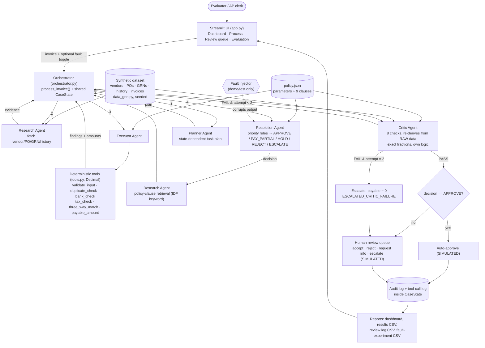
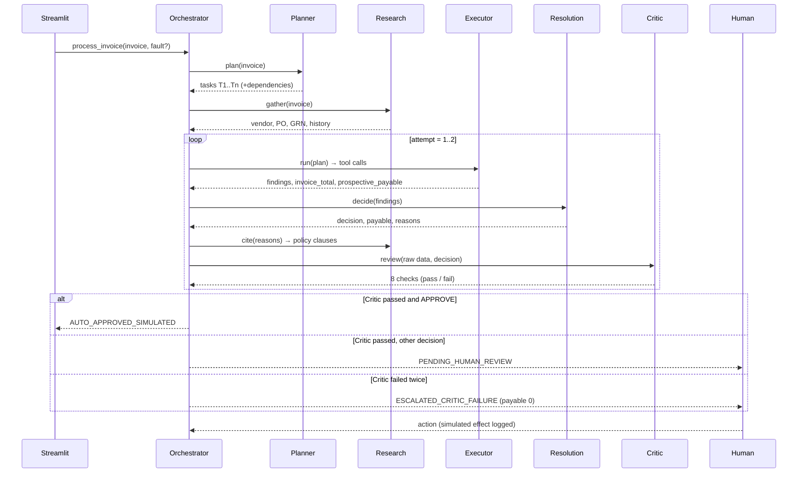

# Architecture (matches the code in `invoiceguard/`)

## 1. Component diagram

## 2. Sequence (one invoice)

## 3. Components and interactions

| Component | File | Input → Output | Failure behaviour |
|---|---|---|---|
| Streamlit UI | `app.py` | user choices → renders `CaseState` | invalid vendor → clear error message |
| Orchestrator | `orchestrator.py` | invoice, dataset → `CaseState` | max 2 attempts, then escalate with payable 0 |
| Planner | `agents.py` | invoice → task list | invalid invoice → shortened plan (validate → decide → critic → route) |
| Research | `agents.py` | invoice → evidence; finding codes → clause ids | missing PO/GRN returned as `None` and handled downstream |
| Executor | `agents.py` + `tools.py` | plan + evidence → findings, amounts | every tool call logged in `tool_calls` |
| Resolution | `agents.py` | findings → decision | first matching finding by priority wins |
| Critic | `agents.py` | raw data + decision → 8 checks | any failed check blocks the decision |
| Fault injector | `orchestrator._inject` | decision → corrupted decision | used only for demo/tests |
| Baseline | `baseline.py` | invoice → APPROVE / MANUAL | comparison only |

## 4. Decision priority (Resolution Agent and Critic implement it separately)
`INPUT_INVALID→HOLD` > `BANK_MISMATCH→ESCALATE` > `DUPLICATE_INVOICE→REJECT` > `NO_PO / SKU_NOT_ON_PO→HOLD` > `NO_GRN→HOLD` > `TAX_RATE_MISMATCH→HOLD` > `PRICE_OVER_TOLERANCE→HOLD` > payable above limit → `ESCALATE` > `QTY_OVER_RECEIVED→PAY_PARTIAL` > `APPROVE`.

## 5. What is LLM / rules / code / retrieval / human
| Element | Kind |
|---|---|
| Plan, decision, routing | rule-based Python |
| Amounts, matching, duplicates, GST | deterministic Python (Decimal) |
| Critic re-derivation | independent Python (exact fractions) |
| Policy clause lookup | retrieval (IDF-weighted keyword overlap) |
| Explanation text | deterministic template; optional local Ollama rephrase (numbers verified, falls back if not matching) |
| Final consequential action | human review (simulated) |
